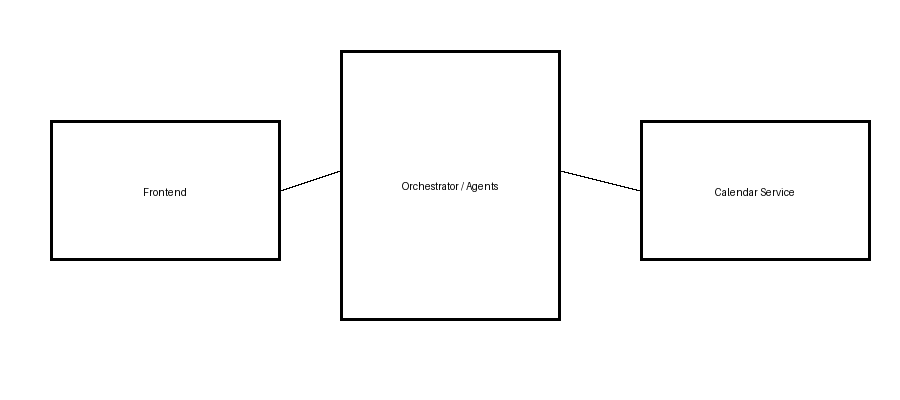
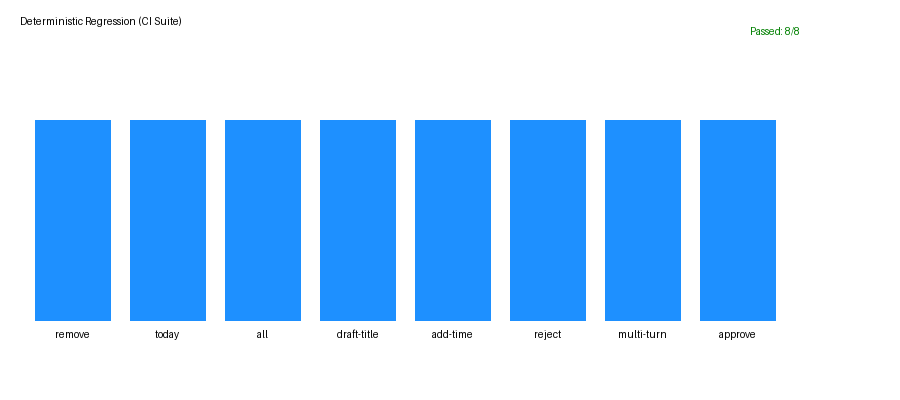

# Axon — Agentic Calendar System

[](https://github.com/Siddharthaaa21/agentic-calendar-system/actions/workflows/ci.yml)
[](LICENSE)
[](https://www.python.org/downloads/)
[](https://fastapi.tiangolo.com)
[](https://streamlit.io)

A conversational AI assistant that manages your Google Calendar in plain English. It understands intent, structures and prioritizes your day, detects scheduling conflicts, finds deep-work focus slots, and proposes create / reschedule / delete actions — but **never touches your real calendar without explicit approval**, thanks to a human-in-the-loop (HITL) gate.

Built with a **FastAPI** backend, a **Streamlit** frontend, and interchangeable LLM reasoning powered by **Groq (Llama 3.1)** or **Anthropic (Claude)** with robust hybrid rule fallbacks.

> **Try it:** `"what's for today"` · `"show conflicts"` · `"free slots"` · `"move gym to 8pm"` · `"delete lunch"`

---

## Why it's built this way

| Design choice | What it buys you |
|---|---|
| **HITL approval gate** (`/execute` queues, `/approve` applies) | The LLM can *propose* but never *commit*. Every mutation is presented to the user before it reaches the calendar — eliminating silent, hallucinated edits. |
| **Multi-agent pipeline** | Intent detection, entity extraction, planning, prioritization, and execution are separate, testable agents instead of a fragile monolithic prompt. |
| **Hybrid fallback resilience** | Deterministic regex rules and template formatters ensure schedule queries, conflicts, and approvals remain operable even during LLM provider rate limits or outages. |
| **Optional API-key auth** | Mutation endpoints are secured behind an `X-API-Key` header with constant-time comparison, plus fail-closed startup warnings when running against live calendars. |
| **Zero-setup demo mode** | Run against an in-memory mock calendar (`DEMO_MODE=true`) — anyone can test the full chat → plan → approve → execute loop with zero Google Cloud configuration. |
| **Deterministic regression suite** | 8 end-to-end multi-turn conversation test cases run on every push via GitHub Actions to prevent regressions. |

---

## Architecture

```
User ↔ Streamlit (frontend/app.py)
            │  HTTP (API_URL, optional X-API-Key)
            ▼
       FastAPI (backend/app/main.py)
            │
   ┌────────┴─────────┐
   │   Orchestrator    │  intent/entity detection → router → workflow
   └────────┬─────────┘
            │
   ┌────────┴─────────┐
   │      Agents       │  planner · prioritizer · execution (Groq / Anthropic)
   └────────┬─────────┘
            │
   ┌────────┴─────────┐
   │ Calendar Service  │  Google Calendar API  — or —  in-memory mock (DEMO_MODE)
   └───────────────────┘
```



For an in-depth walkthrough of data flow, state management, and guardrails, see the [Architecture Guide](docs/ARCHITECTURE.md).

**Repository Layout**
- `backend/` — FastAPI app: agents (intent, entity, planner, prioritizer, execution), orchestrator (router, workflow, context builder), memory stores, and test suites.
- `frontend/` — Streamlit web interface with real-time schedule inspection, conflict highlighting, and approval cards.
- `docs/` — Architecture documentation and visual workflows.
- `tools/` — Helper utilities for asset and graph generation.

---

## Local Setup

### 1. Prerequisites & Environment

Clone the repository and create a Python virtual environment:

```bash
git clone https://github.com/Siddharthaaa21/agentic-calendar-system.git
cd agentic-calendar-system

# Create and activate a virtual environment (Python 3.9+)
python3 -m venv venv
source venv/bin/activate

# Install dependencies
pip install -r backend/requirements.txt
```

### 2. Configure Environment Variables

```bash
cp .env.example .env
```

Key environment variables:
- `LLM_PROVIDER` — `groq` or `anthropic` (default: `anthropic`)
- `GROQ_API_KEY` — Required if using Groq (free at [console.groq.com](https://console.groq.com))
- `ANTHROPIC_API_KEY` — Required if using Anthropic ([console.anthropic.com](https://console.anthropic.com))
- `DEMO_MODE=true` — Run against the mock calendar (recommended for instant local testing without Google credentials)
- `API_KEY` — Optional shared secret requiring an `X-API-Key` header on all mutation endpoints
- `ALLOWED_ORIGINS` — Comma-separated CORS allowlist (defaults to `http://localhost:8501,http://127.0.0.1:8501`)

### 3. Connect Real Google Calendar (Optional, `DEMO_MODE=false`)

1. Create an OAuth 2.0 Client ID (Desktop Application) in the [Google Cloud Console](https://console.cloud.google.com/) with the **Google Calendar API** enabled.
2. Download the client secret JSON file and save it as `backend/credentials.json`.
3. Set `DEMO_MODE=false` and `ALLOW_INTERACTIVE_AUTH=true` in your `.env`.
4. The first backend launch opens a browser to grant calendar permissions; an authorized `backend/token.json` is saved locally for future runs.

### 4. Run the Application

In separate terminal windows with your virtual environment activated:

```bash
# Terminal 1: Backend API → http://127.0.0.1:8000
cd backend
python -m uvicorn app.main:app --reload

# Terminal 2: Frontend Web UI → http://localhost:8501
cd frontend
streamlit run app.py
```

---

## Testing

Run the deterministic regression suite (executes against the mock calendar, zero external credentials required):

```bash
cd backend
python -m app.testing.testing_chat_regression
```

Expected output: `Regression result: 8/8 passed`.



To run individual agent tests:
```bash
python -m app.testing.testing_intend        # Intent classification test suite
python -m app.testing.testing_entity        # Entity extraction test suite
python -m app.testing.testing_conversation  # Conversational turn test suite
```

Continuous integration runs automatically on every commit via GitHub Actions ([`.github/workflows/ci.yml`](.github/workflows/ci.yml)).

---

## Deployment

### Docker (Recommended)

Run both the FastAPI backend and Streamlit frontend in orchestrated containers:

```bash
# Using Groq
GROQ_API_KEY=your_key DEMO_MODE=true docker compose up --build

# Or using Anthropic
LLM_PROVIDER=anthropic ANTHROPIC_API_KEY=your_key DEMO_MODE=true docker compose up --build
```

- Backend runs at `http://localhost:8000`
- Frontend runs at `http://localhost:8501`

### Cloud Split Deployment

- **Backend** (Render / Railway / Fly.io): Deploy `backend/` using `backend/Dockerfile`. Set `GROQ_API_KEY` (or `ANTHROPIC_API_KEY`), `DEMO_MODE=true`, `API_KEY`, and `ALLOWED_ORIGINS=https://<your-frontend-domain>`.
- **Frontend** (Streamlit Community Cloud): Deploy `frontend/app.py`. Under App Settings > Secrets, supply `API_URL=https://<your-backend-domain>` and matching `API_KEY`.

---

## Security & Guardrails

- **Constant-time Secret Auth**: Mutation endpoints enforce `X-API-Key` comparison using `secrets.compare_digest`.
- **Output Sanitization & XSS Defense**: Dynamic calendar content is HTML-escaped before display, and assistant outputs are scrubbed for control characters and delimiter leakage.
- **Fail-Closed Protection**: In non-demo environments (`DEMO_MODE=false`), the backend refuses to boot without `API_KEY` configured, preventing unauthenticated access to live Google Calendars.
- **Payload Quotas**: Mutation endpoints limit requests to a maximum of 25 actions to guard against quota exhaustion.

---

## Known Limits & Roadmap

- **Session Storage**: Current session state is file-backed and single-node; migrate to Redis for horizontally scaled multi-worker deployments.
- **Multi-Tenancy**: The mock calendar demo is globally shared per container instance; production multi-tenant use requires per-user credential and token mapping.
- **Python Runtime**: Tested on Python 3.9+. Upgrading to Python 3.10+ is recommended to avoid Google API core deprecation warnings.

---

## License

This project is licensed under the [MIT License](LICENSE).
