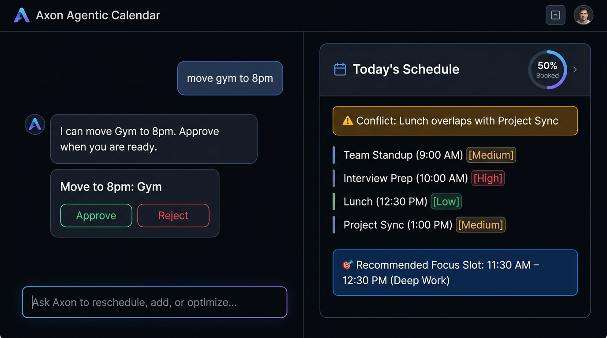

# Axon — Agentic Calendar System

A deterministic, human-in-the-loop (HITL) multi-agent system that manages Google Calendar through natural language. It interprets conversational intent, balances daily workload, detects scheduling conflicts, discovers deep-work focus slots, and stages mutations — but **enforces a strict separation between planning and execution**. The LLM can propose calendar mutations, but can never commit them without explicit user authorization.

Supports both **Groq (Llama 3.1)** and **Anthropic (Claude)** with robust rule-based fallbacks that keep the system operable even when external LLM providers are rate-limited or offline.

---

## Interface



The interface splits into two coordinated views:
- **Left (Conversational HITL Agent):** Multi-turn chat where users state objectives in plain English. Proposed actions are rendered as interactive staging cards with one-click **Approve** and **Reject** buttons.
- **Right (Real-Time Schedule Dashboard):** Live timeline of today's events, color-coded priority badges, automated overlap conflict warnings, and a cognitive workload gauge (`load_pct`).

---

## Architectural Philosophy & Core Invariants

Traditional LLM assistants fail on calendar management because single-prompt approaches hallucinate times, clobber existing meetings, and silently mutate external state. Axon enforces five architectural invariants:

1. **Strict HITL Gate (Propose vs. Commit):** The LLM pipeline only produces mutation *payloads* (`CREATE`, `RESCHEDULE`, `DELETE`), which are staged in session memory. Execution occurs solely via the `/approve` endpoint when the human confirms.
2. **Rules-First, Model-Second:** Deterministic regex engines and heuristic matchers resolve common operations (affirmations, rejections, time offsets, simple verbs) with zero latency and zero LLM cost. The LLM is invoked only for semantic ambiguity.
3. **Batch Over Single-Item Calls:** When classifying or prioritizing today's events, the planner processes the entire schedule in a single batched prompt instead of making $N$ round-trips.
4. **State Machine Durability:** Multi-turn slot filling (e.g. "Add a team sync" $\rightarrow$ "At 3pm") survives across turns via draft state memory and persistence guarantees.
5. **Fail-Closed Security:** Against a real Google Calendar (`DEMO_MODE=false`), the backend refuses to start without an `API_KEY` configured.

---

## System Architecture

```
User ↔ Streamlit Frontend (frontend/app.py)
              │
              │  HTTP JSON (/today, /chat, /execute, /approve)
              │  Optional Header: X-API-Key
              ▼
         FastAPI Backend (backend/app/main.py)
              │
    ┌─────────┴─────────┐
    │   Orchestrator    │  Fast-Path Filter → State Machine → Context Builder
    └─────────┬─────────┘
              │
    ┌─────────┴─────────┐
    │  Agent Pipeline   │
    │  ├─ Intent Agent  │  Hybrid Regex / Fallback LLM (11 intent classes)
    │  ├─ Entity Agent  │  Regex Time/Title Extraction + Gap-Fill LLM
    │  ├─ Planner Agent │  Batch Schema Enrichment & Classification
    │  └─ Prioritizer   │  Workload Scorer & High/Med/Low Assignment
    └─────────┬─────────┘
              │
    ┌─────────┴─────────┐
    │   HITL Gate       │  Stages actions to pending_actions session store
    └─────────┬─────────┘
              │
    ┌─────────┴─────────┐
    │  Calendar Service │  Google Calendar API  — or —  Mock Service (DEMO_MODE)
    └───────────────────┘
```

Detailed architectural diagrams and implementation notes are available in the [Architecture Guide](docs/ARCHITECTURE.md).

---

## Multi-Agent Pipeline Mechanics

Instead of relying on an unpredictable monolithic agent, Axon delegates reasoning across five specialized agents:

| Agent | Module | Input $\rightarrow$ Output | Strategy & Fallback |
|---|---|---|---|
| **Intent Agent** | [`intent_agent.py`](backend/app/agents/intent_agent.py) | Message + Context $\rightarrow$ Intent Tag | **Rules First:** Evaluates 11 deterministic regex patterns and verb prefixes (`GET_TODAY`, `CREATE_EVENT`, `RESCHEDULE_EVENT`, `DELETE_EVENT`, `SHOW_CONFLICTS`, `OPTIMIZE_DAY`, `APPROVE_ACTIONS`, `REJECT_ACTIONS`, etc.). Falls back to structured LLM prompt only when no rule fires. |
| **Entity Agent** | [`entity_agent.py`](backend/app/agents/entity_agent.py) | Message + Context $\rightarrow$ `{event_title, time}` | **Hybrid Extraction:** Regex extracts standardized and bare times (`"8pm"`, `"at 3"` $\rightarrow$ `3:00 PM`), while title patterns isolate target events. LLM gap-fills missing context. Both pass through strict validation blocks (`_validate_title`, `_validate_time`). |
| **Planner Agent** | [`planner_agent.py`](backend/app/agents/planner_agent.py) | Raw Calendar Events $\rightarrow$ Normalized Events | Normalizes raw Google Calendar JSON into typed domain objects with parsed UTC bounds, duration, and default metadata. Executes batched schema enrichment. |
| **Prioritizer Agent** | [`prioritizer_agent.py`](backend/app/agents/prioritizer_agent.py) | Normalized Events $\rightarrow$ Prioritized Events | Computes daily workload saturation (`load_pct`) relative to a 10-hour (600 min) workday. Applies deterministic keyword rules (e.g. `"interview"`, `"presentation"` $\rightarrow$ `HIGH`) before invoking model ranking. |
| **Execution Agent** | [`execution_agent.py`](backend/app/agents/execution_agent.py) | Approved Actions $\rightarrow$ Mutation Results | Pure deterministic executor. Never touches LLMs. Applies authenticated mutations (`insert`, `patch`, `delete`) to the calendar service. |

---

## State Machine & Multi-Turn Context

Axon handles complex conversational state across multiple turns without losing context:

```
Turn 1: "Add a meeting called Project Sync"
  └─ Intent: CREATE_EVENT | Entities: title="Project Sync", time=None
  └─ State Machine: saves {title: "Project Sync"} to draft_create_event
  └─ Reply: "What time would you like to schedule Project Sync?"

Turn 2: "at 4pm"
  └─ Intent: CREATE_EVENT (via multi-turn resolver) | Entities: time="4:00 PM"
  └─ Merge: combines draft title + new time
  └─ Orchestrator: generates staged action [{action: "create", title: "Project Sync", start: "..."}]
  └─ Reply: "I can create Project Sync at 4:00 PM. Approve when you're ready."
  └─ Persistence: _persist_pending() guarantees action is saved to pending_actions

Turn 3: "yes" / [Approve Button]
  └─ Intent: APPROVE_ACTIONS
  └─ Execution Agent: commits event to Calendar API
  └─ Cache: calls invalidate_event_cache() to refresh dashboard view
```

### Contextual Fast-Paths & Protections
- **Small-Talk Fast Paths:** Casual phrases (`"hi"`, `"thanks"`, `"how are you"`) match compiled regex guards to return immediate conversational responses, skipping context construction.
- **Slot Filling:** Asking `"free slots"` locates open focus windows; follow-up queries like `"put focus time in that slot"` automatically bind the calculated time range.
- **High-Priority Safeguard:** The router rejects reschedule proposals on events marked `priority == "high"`, protecting critical appointments from accidental movement.

---

## Guardrails & Security Architecture

- **Fail-Closed Authentication:** Set `API_KEY` to require an `X-API-Key` header on all mutation endpoints. If `DEMO_MODE=false` (live Google Calendar) and `API_KEY` is omitted, the server **aborts boot** to prevent exposing open mutation endpoints.
- **Constant-Time Verification:** API key authentication uses `secrets.compare_digest` to prevent timing attacks.
- **Action Batch Quotas:** `MAX_ACTIONS_PER_REQUEST = 25` prevents accidental or malicious quota exhaustion on the Google Calendar API.
- **XSS & Prompt Injection Defenses:** Dynamic event titles and user inputs are strictly escaped via `html.escape()` before interpolation into the UI. Assistant replies pass through `sanitize_output()` to strip control characters and delimiter injection.
- **Isolated Session Memory:** Requests bind a per-session UUID via `set_session()`, isolating conversation history and pending action queues across multiple users.

---

## Quickstart

### 1. Setup Virtual Environment

```bash
git clone https://github.com/Siddharthaaa21/agentic-calendar-system.git
cd agentic-calendar-system

# Create virtual environment (Python 3.9+)
python3 -m venv venv
source venv/bin/activate

# Install dependencies
pip install -r backend/requirements.txt
```

### 2. Configure Environment

```bash
cp .env.example .env
```

Set key values in `.env`:
```ini
LLM_PROVIDER=groq                     # "groq" or "anthropic"
GROQ_API_KEY=gsk_your_groq_key        # Free at console.groq.com
# ANTHROPIC_API_KEY=sk-ant-your_key  # Optional Anthropic key
DEMO_MODE=true                        # true = mock calendar (no Google setup)
```

### 3. Run Locally

In separate terminal windows:

```bash
# Terminal 1: FastAPI Backend -> http://127.0.0.1:8000
cd backend
python -m uvicorn app.main:app --reload

# Terminal 2: Streamlit UI -> http://localhost:8501
cd frontend
streamlit run app.py
```

---

## Testing & CI Verification

Axon includes a deterministic regression test suite covering all multi-turn dialogue patterns, drafting states, and approval flows against the mock calendar:

```bash
cd backend
python -m app.testing.testing_chat_regression
```

```
✅ remove checking -> DELETE_EVENT with one action
✅ todays tasks -> GET_TODAY and no create/delete action
✅ all tasks? -> GET_TODAY and not hijacked by stale draft
✅ create with title only -> asks for time (no executable action yet)
✅ then 9 pm -> creates pending CREATE action for draft title
✅ no -> rejects pending actions
✅ add yoga -> 8am -> pending CREATE action
✅ yes -> applies the pending multi-turn CREATE (not 'nothing pending')
---------------------------------
Regression result: 8/8 passed
```


Run individual component test suites:
```bash
python -m app.testing.testing_intend        # Intent classification test suite
python -m app.testing.testing_entity        # Entity extraction test suite
python -m app.testing.testing_conversation  # Multi-turn conversation test suite
```

Continuous integration runs automatically on push/PR via [GitHub Actions](.github/workflows/ci.yml).

---

## Docker Deployment

Run both the FastAPI backend and Streamlit frontend via Docker Compose:

```bash
# Launch with Groq
GROQ_API_KEY=your_key DEMO_MODE=true docker compose up --build

# Or with Anthropic
LLM_PROVIDER=anthropic ANTHROPIC_API_KEY=your_key DEMO_MODE=true docker compose up --build
```

- Backend API: `http://localhost:8000` (Health check at `/`)
- Frontend UI: `http://localhost:8501`

---

## Connecting Real Google Calendar & Live Multi-User Access

Axon supports **multi-tenant, one-click Web OAuth** so any visitor accessing the deployment can sign in with their own Google account and manage their personal calendar in complete isolation.

### 1. Web OAuth Flow (Any Visitor)
- Visitors arriving at the deployed application (e.g. `https://axon-calender.streamlit.app`) start in **Sample Demo Sandbox** mode.
- Clicking **"🚀 Sign in with Google Calendar"** directs them to Google's official consent screen.
- Upon consent, Google redirects back with an authorization code (`?code=...`).
- Axon automatically exchanges the code, binds the OAuth tokens to that visitor's unique session ID, and renders their real schedule, timings, and conflicts.
- **Tenant Isolation:** Visitor A's calendar data and actions are strictly isolated from Visitor B. Sessions never share credentials.
- Users can click **Disconnect** at any point to clear tokens and return to the sandbox.

### 2. Google Cloud Console Setup (Deployment)
1. Go to the [Google Cloud Console Credentials page](https://console.cloud.google.com/apis/credentials).
2. Under your OAuth 2.0 Client ID, add the following to **Authorized redirect URIs**:
   - `https://axon-calender.streamlit.app` (for Streamlit Cloud production)
   - `http://localhost:8501` (for local development)
3. Under **OAuth consent screen**:
   - Ensure the Google Calendar scope (`https://www.googleapis.com/auth/calendar`) is added.
   - If the app is in *Testing* mode, add your Google email under **Test users**; or set the app to *Production* (External).
4. Save your client credentials in `backend/credentials.json` or configure `GOOGLE_CLIENT_ID` and `GOOGLE_CLIENT_SECRET` in Streamlit Secrets.

---

## Known Limitations & Production Roadmap

- **Session Store:** File-backed JSON session persistence is single-node. A production horizontal deployment should swap `session_memory.py` for Redis.
- **Tenant Isolation:** In `DEMO_MODE=true`, mock state is container-global; production setups require mapping authenticated user identities to individual calendar service sessions.
- **Python Target:** Google API client libraries issue EOL notices on Python 3.9; Python 3.10+ is recommended for production container deployments.

---

## License

Distributed under the [MIT License](LICENSE).
